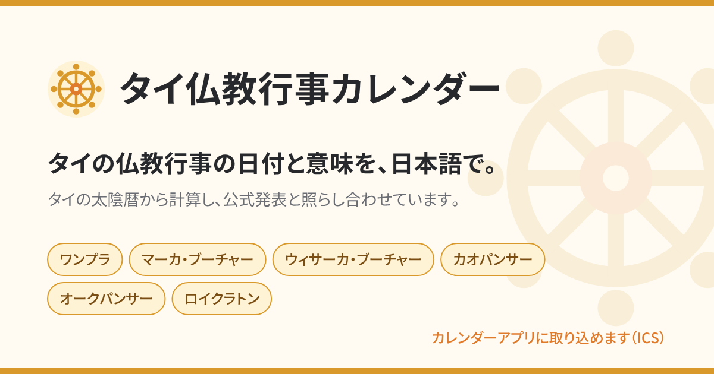

<p align="center">
  <picture>
    <source media="(prefers-color-scheme: dark)" srcset="./docs/assets/logo-dark.svg" />
    
  </picture>
</p>

<p align="center">
  タイ仏教の行事の日付と意味を、日本語で。
</p>

<p align="center">
  <a href="https://koyomi.tkc310.com">https://koyomi.tkc310.com</a>
  ・
  <a href="https://github.com/tkc310/koyomi/actions/workflows/ci.yml"></a>
</p>

<p align="center">
  
</p>

## 概要

タイ仏教の行事（ワンプラ、マーカ・ブーチャー、ウィサーカ・ブーチャー、カオパンサーなど）の日付と由来・行うことを、日本語でまとめたカレンダーです。日付はタイの太陰暦から計算し、タイ政府・タイ中央銀行の公式発表と照らし合わせています。

## 特徴

- **扱う行事**: ワンプラ（布薩日）、マーカ・ブーチャー、ウィサーカ・ブーチャー、アッタミー・ブーチャー、アーサーラハ・ブーチャー、カオパンサー、オークパンサー、トートカティン。民間行事としてロイクラトンとソンクラーン（ADR-0007）
- **太陰暦から計算し、公式告示で確かめる**: 閏月・閏日を含むタイ太陰暦の年表から日付を計算し、公式の日付と食い違う年だけ年型を上書きします（ADR-0008・0009）。公式の日付と出典は `tests/fixtures/` にあり、テストで毎回照合します
- **カレンダーアプリに取り込める**: 今年と来年の行事を ICS（`calendar.ics`）で配っています。Google カレンダー、iPhone、Outlook に終日の予定として入ります
- **ホーム画面に追加・オフライン**: PWA として追加でき、一度開くと電波の届かない場所でも見られます（ADR-0013）
- **日本語だけの表記**: 行事名は「カタカナ（日本語訳）/ ローマ字」で書き、サイトと ICS にタイ文字を出しません（ADR-0012）
- **出典つきの解説**: 行事ごとの由来・行うことと、功徳を積む行い（タンブン）の説明に、経典や公式発表の出典を付けています

## 使い方

- **サイトで見る**: https://koyomi.tkc310.com を開きます。月ごとのカレンダーと行事の一覧があり、行事を押すと詳しい説明のページへ移ります
- **カレンダーアプリに取り込む**: トップページの「カレンダーアプリに取り込む」から `calendar.ics` をダウンロードし、各アプリの手順で取り込みます。取り込んだ予定は自動では更新されないので、年が変わったら取り込み直してください
- **ホーム画面に追加する**: iPhone は Safari の共有 →「ホーム画面に追加」、Android は Chrome のメニュー →「ホーム画面に追加」/「アプリをインストール」、パソコンは Chrome・Edge のアドレスバーのインストールから追加できます

## 開発

```sh
make setup   # .tool-versions の Node.js・pnpm を入れて、依存をインストールする（mise か asdf が必要）
make dev     # http://localhost:4321
make check   # fmt・lint・型
make test    # テスト
```

コマンドの一覧、ブランチと PR の流れ、リリースの手順は [CONTRIBUTING.md](./CONTRIBUTING.md) にあります。

### 技術スタック

| 分野       | 使っているもの                                                                          |
| ---------- | --------------------------------------------------------------------------------------- |
| サイト     | [Astro](https://astro.build/)（静的出力）、React（8341-ui の部品）、Tailwind CSS        |
| デザイン   | [8341-ui](https://tkc310.github.io/8341-ui/)（shadcn のレジストリで取り込む。ADR-0003） |
| ツール     | [Vite+](https://viteplus.dev/)（fmt・lint・test）、Vitest、`astro check`、Makefile      |
| 版の管理   | `.tool-versions`（mise / asdf）、pnpm                                                   |
| 配信       | Cloudflare Workers の静的アセット（ADR-0016）、GitHub Actions                           |
| オフライン | 自前の Service Worker（`public/sw.js`）                                                 |

### PWA の仕組み

- `public/manifest.webmanifest`: 名前・アイコン・色・`display: standalone`
- `public/icons/`・`public/favicon.*`: 法輪のアイコン（`src/components/site/dharma-wheel.ts`）。形や色を変えたら `make icons` で作り直してコミットする
- `public/sw.js`: 全ページ・`calendar.ics`・アイコンを保存し、ページと ICS はネットワークを先に見て、つながらないときに保存した版を返す。保存する URL と版（中身のハッシュ）は、ビルドの最後に `src/integrations/service-worker.ts` が `dist/sw.js` に書き込む
- 登録は本番ビルドだけ（`make dev` では登録しない）。確かめるときは `make build` のあと `make preview` で開く

### ディレクトリ構成

```text
src/core/        暦計算（Astro・React に依存しない純粋関数）
src/data/        行事の定義（ローマ字 / カタカナ / 日本語訳）
src/content/     行事・タンブンの本文（Markdown）
src/pages/       ページ・calendar.ics・sitemap.xml・robots.txt
src/layouts/     レイアウト（OGP・canonical・JSON-LD）
src/components/ui/, src/lib/, src/styles/8341-ui.css
                 8341-ui から取り込んだ生成物（直接編集しない。更新は make ui-add）
scripts/         アイコン・ロゴ・OGP バナーを作るスクリプト
tests/           テスト
tests/fixtures/  日付の正解データ（出典 URL 必須）
docs/            設計判断（ADR）・改善ログ・行事ごとの資料
```

## デプロイ

`main` にマージすると、CI が通った後に `.github/workflows/deploy.yml` が `make deploy` を走らせ、https://koyomi.tkc310.com に公開されます（ADR-0016）。手順と必要な設定は [CONTRIBUTING.md のリリース](./CONTRIBUTING.md#リリース) にあります。

定期作業は年 1 回だけです。毎年 12 月に翌年分の公式告示を照合してデプロイします（ADR-0015、[docs/operations.md](./docs/operations.md)）。

## ドキュメント

| 文書                                                 | 中身                                          |
| ---------------------------------------------------- | --------------------------------------------- |
| [CONTRIBUTING.md](./CONTRIBUTING.md)                 | 開発とリリースの手順                          |
| [docs/README.md](./docs/README.md)                   | 開発に関する文書の入口                        |
| [docs/decisions/](./docs/decisions/README.md)        | 設計判断の記録（ADR）                         |
| [docs/events/](./docs/events/README.md)              | 行事ごとの資料（日付の決め方と出典）          |
| [docs/operations.md](./docs/operations.md)           | 定期作業（毎年 12 月の照合とデプロイ）        |
| [docs/improvement/log.md](./docs/improvement/log.md) | 直したことの記録                              |
| [CLAUDE.md](./CLAUDE.md)・[AGENTS.md](./AGENTS.md)   | ドメインのルールと、AI エージェント向けの指示 |

## ライセンス

未定です（追加予定）。
